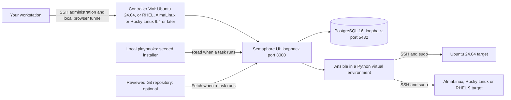
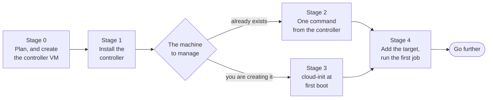

# Ansible + Semaphore: build, understand and operate a small lab

A general, self-contained guide to building a native Ansible and Semaphore UI
controller, managing Ubuntu and Enterprise Linux targets, and learning how to
verify and recover your automation.

**Start with one manual walkthrough, then automate repeatable work.** You will
run the same playbooks from the terminal and from Semaphore, inspect the
results, repair deliberate drift, and practice recovery.

This repository contains example configuration and code. It contains **no
working credentials, private inventories, cloud account identifiers, database
dumps or deployment-specific recovery material**. Replace `*.example.test`
hostnames with your own addresses and generate credentials locally.

## What you will build



The controller runs on a dedicated VM. Ansible connects to the targets over
SSH; the targets do not need an Ansible agent. Semaphore supplies the web
interface, credentials, job configuration and task history. It runs Ansible;
it does not replace the playbooks.

## The workflow

Follow the stages in order. Each one is a page with the same shape: Goal, Do,
Check, the values to save, and what to do when a step fails.

For the short way through stages 0 and 1, open [the setup page](site/README.md),
`site/index.html`: it asks where the controller will run, which system it
runs and who its administrator is, and lists the steps for that case with each
command ready to copy. A new VM can then
[install the controller at its first boot](docs/first-boot-controller.md).



| Stage | Do | Where it runs | You end with |
| --- | --- | --- | --- |
| 0 | [Plan the lab and create the controller VM](docs/stage-0-plan.md) | Your hypervisor or cloud | One clean VM for the controller, and a private worksheet for the values the next stages produce. |
| 1 | [Install the controller](docs/stage-1-controller.md) | The controller VM | Semaphore with 24 templates on eight tabs, the lab folder, and the service key that targets will trust, with a copy in your home folder. One installer for Ubuntu 24.04, one for RHEL, AlmaLinux or Rocky Linux 9.4 or later. |
| 2 | [Onboard a machine that already exists](docs/stage-2-existing-machines.md) | The controller, over SSH to the machine | One command, [`onboard-target.sh`](controller/onboard-target.sh), runs [`onboard-linux.sh`](onboard/existing/onboard-linux.sh) on the machine and adds it to the inventory. By hand, at the console or with Ansible, the script gives four lines of data for the controller instead. |
| 3 | [Pre-deploy new VMs with cloud-init](docs/stage-3-new-vms-cloud-init.md) | The new VM, at its first boot | The same account, made by [`cloud-init.yaml`](onboard/new-vm/cloud-init.yaml) before you ever log in, optionally with its sudo password set, and the same four lines. |
| 4 | [Add the target and run the first job](docs/stage-4-add-target-first-job.md) | The controller, then Semaphore | The target in the inventory with its verified host key, the sudo password in Semaphore through [`lab-sudo.py`](controller/lab-sudo.py), and **Ping** and **Baseline preview** green for it. |

Stages 2 and 3 are alternatives, chosen per machine; do either once for each
machine, then Stage 4. [The whole path as one flowchart](docs/ONBOARDING.md)
shows every branch with the file for each step.

### The short path

What you type, after Stage 0 gave you a controller VM, for **one machine that
already exists**. On the controller, as your administrator; install `git`
first where the image lacks it, read the plan before `--apply`, and use
`install-controller-el9.sh` on Enterprise Linux:

```bash
git clone https://github.com/kevo099/ansible-semaphore-guide.git ~/ansible-semaphore-guide
cd ~/ansible-semaphore-guide
bash controller/install-controller.sh --plan
sudo bash controller/install-controller.sh --apply
bash controller/onboard-target.sh ADMIN@VM_ADDRESS
sudo python3.12 controller/lab-sudo.py
```

Then [open Semaphore](docs/stage-1-controller.md#do-open-semaphore) and run
**Ping** and **Baseline preview** on the **Baseline** tab. The fifth command
needs SSH from the controller to the machine as its administrator. For **one
new VM** instead, the last two commands become these three:
fill the cloud-init file with the sudo password's hash; give the file to the
VM at its creation, as Stage 3 shows for your platform; then add the VM from
the lines its console prints, and give Semaphore the password:

```bash
(umask 077 && bash onboard/new-vm/fill-cloud-init.sh --with-password ~/svc_ansible.pub > ~/onboard-new-vm.yaml)
sudo bash controller/add-target.sh --from-info
sudo python3.12 controller/lab-sudo.py
```

[The runbooks](docs/runbooks.md) give the same kind of short sequence for the
tasks that come later.

The examples are platform-neutral, with two worked platforms:
[Proxmox VE](docs/platform-proxmox.md), where the cloud-init file is attached
to a VM or a template as vendor data, and [Azure](docs/platform-azure.md),
where it is custom data and Run Command stands in for the console.

## Go further

A controller with one onboarded target is the starting point for the rest.

**Learn and operate.** Take them in this order.

| Guide | Result |
| --- | --- |
| [Runbooks: common tasks](docs/runbooks.md) | Onboard, check health, reboot, retire, change the sudo password, recover from a rebuild: one short recipe each. |
| [Command-line Ansible lessons](docs/05-cli-lessons.md) | Preview, apply, repeat and inspect five playbooks from the terminal. |
| [Semaphore's objects](docs/06-semaphore.md) | Understand the project, keys, inventory and templates the installer seeded, or build them by hand. |
| [Git and VS Code](docs/07-git-and-vscode.md) | Edit, review and deliberately deliver changes. |
| [Backup, restore and rebuild](docs/10-recovery.md) | Take a recovery capture before you patch or harden anything. |
| [Patching and daily operations](docs/08-operations.md) | Handle maintenance, reboots, drift and failures. |
| [Optional CIS/STIG practice](docs/09-security-benchmarks.md) | Assess a vendor baseline, or a DISA SCAP benchmark file you supply, on disposable targets. The [security baseline catalog](docs/appendices/security-baselines.md) compares baselines by platform. |
| [Learning exercises and RHCE alignment](docs/12-learning-path.md) | Progress toward independently written automation. |
| [Troubleshooting](docs/11-troubleshooting.md) | Whenever a check fails: network, SSH, sudo, then Semaphore. |

**Semaphore Community features.** Each chapter was written from a live test of
Semaphore Community 2.19.12 and says what is free, what is paid and what to
watch for. Read 14 and 15 first; then 16, 17 and 18 as you need them.

| Guide | Result |
| --- | --- |
| [14. Inputs and templates](docs/14-inputs-and-templates.md) | Variable groups, surveys, launch options, build and deploy templates. |
| [15. Identity, roles and credentials](docs/15-identity.md) | Users, the four project roles, API tokens, TOTP and where secrets belong. |
| [16. Schedules, notifications and task control](docs/16-semaphore-operations.md) | Run on a timetable, get alerts, limit concurrency and stop tasks safely. |
| [17. API and integrations](docs/17-api-and-integrations.md) | Launch and watch tasks from scripts and authenticated webhooks. |
| [18. Runners](docs/18-runners.md) | Run tasks on a separate execution host. |

[Community coverage](docs/COMMUNITY-COVERAGE.md) lists every capability with
its edition and test result. Appendices cover
[browser access](docs/appendices/browser-access.md),
[moving the lab folder to Git](docs/appendices/git-migration.md),
[other task apps](docs/appendices/other-apps.md),
[OpenID Connect and LDAP](docs/appendices/identity-providers.md),
[task identity with OpenBao](docs/appendices/task-identity.md) and
[export, key rotation and upgrades](docs/appendices/maintenance.md).

**How it works underneath.** The installer and the onboarding files do in one
run what these pages do by hand:
[build the Ubuntu controller by hand](docs/manual-controller-ubuntu.md) and
[SSH, sudo and the automation account by hand](docs/manual-access.md).
To bring an installed controller up to a newer release of this guide, see
[update a controller](docs/controller-update.md).

## What is in this repository

The folders follow where a file runs.

| Folder | What it holds | Stage |
| --- | --- | --- |
| [`controller/`](controller/) | What runs on the controller: the two installers, `onboard-target.sh`, `add-target.sh`, `lab-sudo.py`, `remove-target.sh`, the updater, the exposure script, the readiness check and the service unit templates. | 1, 2 and 4 |
| [`onboard/existing/`](onboard/README.md) | What prepares a machine that already exists: `onboard-linux.sh` for the machine itself, and `bootstrap-existing-vm.yml` for the controller to run against it. | 2 |
| [`onboard/new-vm/`](onboard/README.md) | What prepares a new VM at first boot: `cloud-init.yaml`, and `fill-cloud-init.sh` to put the service key into it. | 3 |
| [`onboard/`](onboard/README.md) | `inventory-info.sh`, which prints a prepared machine's values again and changes nothing, and the folder's README. | 2 and 3 |
| [`playbooks/`](playbooks/) | The lessons, the operations playbooks and the STIG playbooks, which the installers copy into the controller's lab folder; [`playbooks/stig/`](playbooks/stig/) has one folder per operating system and version. | 4 and after |
| [`platforms/azure/`](platforms/azure/README.md) | Playbooks that create, stop and remove an Azure lab, in run order. | Optional |
| [`examples/semaphore/`](examples/semaphore/) | Small playbooks for the Semaphore feature chapters. | Optional |
| [`inventories/`](inventories/) | Example inventories; your own stay private. | 2, by-hand path |
| [`docs/`](docs/README.md) | The stage pages, chapters, appendices and validation records. | |
| [`site/`](site/README.md) | The setup page: three questions, then the steps of stages 0 and 1 for your case, with each command ready to copy. Open `site/index.html` in a browser. | 0 and 1 |
| [`scripts/`](scripts/) | `summarize_xccdf.py`, which the lab folder copies for the STIG lessons, `validate.py` for this repository's own checks, and the wrappers `add-target.sh` and `update-controller.sh`, which call the files in `controller/` for copies that still name the old path. | |
| [`tests/`](tests/) | Offline tests of the scripts, playbooks and documents. | |

The files you run yourself, one by one:

| File | Runs on | What it does |
| --- | --- | --- |
| [`controller/install-controller.sh`](controller/install-controller.sh) | The controller | Shows a plan by default; `--apply` installs a fresh Ubuntu 24.04 controller and seeds the project **Ansible Automation**, which runs the playbooks from a local folder. Supports `--editor`, `--lab-dir`, `--expose` and `--address`. |
| [`controller/install-controller-el9.sh`](controller/install-controller-el9.sh) | The controller | The same installation and options for RHEL, AlmaLinux or Rocky Linux 9.4 or later. |
| [`controller/first-boot/user-data.yaml`](controller/first-boot/user-data.yaml) | A new controller VM, at first boot | Installs the controller before you log in: vendor data on Proxmox or a seed ISO, custom data on Azure. It fetches the guide and runs [`controller/first-boot.sh`](controller/first-boot.sh), which runs the installer and the readiness check. [The first-boot page](docs/first-boot-controller.md) shows each way. |
| [`controller/onboard-target.sh`](controller/onboard-target.sh) | The controller, as your administrator, without `sudo` | Prepares existing machines over SSH with `onboard-linux.sh` and adds each one with `add-target.sh`, in one command; asks once for the shared sudo password. |
| [`onboard/existing/onboard-linux.sh`](onboard/existing/onboard-linux.sh) | The machine, as root | Prepares an existing machine: run for you by `onboard-target.sh`, or by hand with `sudo bash` over SSH or at the console (`--keys`, `--ask-password`, `--controller-address`), or through Azure Run Command. Prints the values that `add-target.sh --from-info` reads. |
| [`onboard/existing/bootstrap-existing-vm.yml`](onboard/existing/bootstrap-existing-vm.yml) | The controller | Prepares an existing machine over SSH as its administrator, one host per run. |
| [`onboard/new-vm/fill-cloud-init.sh`](onboard/new-vm/fill-cloud-init.sh) | The controller | Prints `cloud-init.yaml` with the service key in place of its one placeholder; with `--with-password`, also the sudo password's hash, so the VM arrives with it set. |
| [`onboard/new-vm/cloud-init.yaml`](onboard/new-vm/cloud-init.yaml) | A new VM, at first boot | Prepares the VM before you log in: vendor data on Proxmox or in a NoCloud seed, custom data on Azure. |
| [`onboard/inventory-info.sh`](onboard/inventory-info.sh) | A prepared machine, read-only | Prints its values for `add-target.sh --from-info` again. |
| [`controller/add-target.sh`](controller/add-target.sh) | The controller | Adds a host to the lab inventory only when its scanned host key matches the fingerprint you read from its console or from the onboarding output; a repeat changes nothing. With `--from-info` it reads the lines a VM printed as data, never as commands, and checks each value. |
| [`controller/lab-sudo.py`](controller/lab-sudo.py) | The controller | Stores the targets' shared sudo password in Semaphore as the key **Target sudo password** and chooses it for the lab inventory; `--replace` changes it. |
| [`controller/remove-target.sh`](controller/remove-target.sh) | The controller | Retires a target: removes its inventory line and trusted host key, keeping a backup of the inventory. Changes only the controller. |
| [`controller/expose-semaphore.sh`](controller/expose-semaphore.sh) | The controller | Publishes the UI on the VM's address behind an nginx TLS proxy, or in plain HTTP, or reverts to loopback. |
| [`controller/check-controller.py`](controller/check-controller.py) | The controller | Checks services, permissions and loopback listeners without printing credentials. |
| [`controller/update-controller.sh`](controller/update-controller.sh) | The controller | Brings an installed controller up to this copy of the guide; plan by default. |
| [`controller/update-runtime.sh`](controller/update-runtime.sh) | The controller | Brings an older controller's Ansible runtime and Semaphore's SSH connection reuse up to this copy of the guide; plan by default. |

The lesson and operations playbooks:

| File | What it does |
| --- | --- |
| [`playbooks/baseline/ping.yml`](playbooks/baseline/ping.yml) | Checks SSH/Python and identifies the target OS. |
| [`playbooks/baseline/baseline.yml`](playbooks/baseline/baseline.yml) | Manages a login banner and the time service. |
| [`playbooks/examples/users.yml`](playbooks/examples/users.yml) | Creates reserved, ordinary example accounts. |
| [`playbooks/examples/webserver.yml`](playbooks/examples/webserver.yml) | Deploys a templated nginx page on target loopback port 8080. |
| [`playbooks/patching/patch.yml`](playbooks/patching/patch.yml) | Updates one target at a time; reboot defaults to disabled. |
| [`playbooks/operations/report.yml`](playbooks/operations/report.yml) | Reports each host's health without sudo and changes nothing: the **Health report** template on the **Operations** tab. |
| [`playbooks/operations/reboot.yml`](playbooks/operations/reboot.yml) | Reboots exactly one target per run after an explicit acknowledgement, and shows its boot before and after: **Reboot one target**. |
| [`playbooks/stig/audit.yml`](playbooks/stig/audit.yml) | Scans each selected target with the OS vendor's STIG content and fetches the report, names the STIG release it measured and lists the open rules by DISA category; changes no policy. |
| [`playbooks/stig/apply.yml`](playbooks/stig/apply.yml) | Applies the vendor's own STIG remediation to exactly one target per run after an explicit recovery-point approval, with before and after scans. Both STIG playbooks leave out the rules of an [exceptions file](docs/09-security-benchmarks.md#leave-out-rules-you-have-an-accepted-exception-for). |
| [`playbooks/stig/`](playbooks/stig/) | `rhel/9`, `almalinux/9`, `rocky/9` and `ubuntu/24.04`, each with an `audit.yml` and `apply.yml` for that system only; the seeded Semaphore tabs use them. |

All these playbooks require an explicit `--limit`. The nginx lesson owns its
target's entire nginx configuration; use a disposable target where it cannot
replace an application you need. The users lesson owns only reserved `lab_`
accounts. Read each playbook before running it.

### Coming from an earlier copy

Up to v1.8.0 the controller's tools were in `scripts/`, the onboarding files
in `examples/onboard/` and the Azure playbooks in `examples/azure/`. Most
files only moved, and the paths they print now name the new folders. Three
things changed with them: `cloud-init.yaml` now also
works as vendor data, `add-target.sh --from-info` also reads lines with a
console or journal stamp before `onboard:`, and `fill-cloud-init.sh` is new.
Use this copy's files, not copies you filled from an earlier one:

| Earlier path | Now |
| --- | --- |
| `scripts/install-controller.sh`, `install-controller-el9.sh`, `add-target.sh`, `update-controller.sh`, `update-controller.py`, `expose-semaphore.sh`, `check-controller.py`, `seed-semaphore.py`, `controller-common.sh`, `controller_config.py`, `create-admin.py`, `create-database.py` | `controller/`, with the same names; `scripts/add-target.sh` and `scripts/update-controller.sh` remain as wrappers that call the new files |
| `templates/` | `controller/templates/` |
| `examples/onboard/onboard-linux.sh`, `examples/bootstrap-existing-vm.yml` | `onboard/existing/` |
| `examples/onboard/cloud-init.yaml` | `onboard/new-vm/` |
| `examples/onboard/inventory-info.sh`, `examples/onboard/README.md` | `onboard/` |
| `examples/azure/` | `platforms/azure/` |
| Chapters 1 to 4 and 13 | The stage pages, the by-hand pages and the platform pages above |

Nothing moves on an installed controller: its lab folder keeps `playbooks/`,
`ansible.cfg` and `scripts/summarize_xccdf.py`, and its Semaphore templates
keep their paths. `scripts/add-target.sh` and `scripts/update-controller.sh`
still work in this copy and pass their options on to the new files, because
VMs prepared earlier print the first and the update steps of earlier releases
name the second. [Update a controller](docs/controller-update.md) has the
steps.

## Version baseline

| Component | Guide baseline |
| --- | --- |
| Native controller | Seeded installers for Ubuntu Server 24.04 LTS, amd64, and RHEL, AlmaLinux or Rocky Linux 9.4 or later, x86_64 (RHEL registered, with BaseOS and AppStream enabled); Ubuntu also has a manual path |
| Controller Python | 3.12 in the operating system; separate Ansible virtual environment |
| Ansible Core | 2.21.4, with every Python dependency pinned in [`requirements-controller.txt`](requirements-controller.txt) |
| Semaphore UI | Community 2.19.12, checksum-verified native binary |
| Database | PostgreSQL 16 from Ubuntu repositories or the EL9 `postgresql:16` module stream |
| Main practice targets | Ubuntu 24.04, AlmaLinux 9 and Rocky Linux 9 |
| Optional vendor targets | Registered RHEL 9; Ubuntu 24.04 attached to Ubuntu Pro for the Ubuntu Security Guide |

These are the tested versions, not a claim that they are the newest releases.
Semaphore is pinned by version and checksum, and the Ansible environment by
`requirements-controller.txt`. Python 3.12, PostgreSQL 16 and the other
operating-system packages follow the distribution's updates within the release
series shown. Review release notes and rerun validation before upgrading. No
container runtime, Kubernetes cluster, domain controller or paid Semaphore
feature is required for the main walkthrough. The optional feature chapters
use a container runtime only for disposable practice services such as a local
mail catcher or identity provider.

The ansible-core lines have fixed support dates. 2.20 becomes security-only on
2 November 2026 and reaches end of life in May 2027. 2.21 is the last line that
runs on Python 3.12, the controller Python of Ubuntu 24.04 and of the EL9
`python3.12` package; it reaches end of life in November 2027. 2.22, planned
for November 2026, needs Python 3.13 or later on the controller. Managed nodes
on EL9's Python 3.9 stay supported through 2.22, and 2.23 plans to drop Python
3.9. The [release and maintenance
table](https://docs.ansible.com/projects/ansible/latest/reference_appendices/release_and_maintenance.html)
has the current dates.

See [validation and limitations](docs/VALIDATION.md) for what the September
2026 runs on fresh VMs, registered RHEL and Ubuntu Pro guests and Rocky Linux
verified, the 2.21.4 requalification and the Community feature campaign, what
they did not establish, and how to repeat the offline checks.
This is a learning setup, not a high-availability production design or a claim
of compliance with a security standard.

## Reading further

[Official references](docs/REFERENCES.md) link to Ansible, Semaphore, PostgreSQL,
Ubuntu, Red Hat and platform documentation. The examples use their public
interfaces; vendor benchmark content is installed from its own distribution
channels rather than redistributed here.
