# The whole path as one flowchart

[Back to the guide](../README.md)

This page is the map of [the workflow](../README.md#the-workflow): every path
from a Linux machine, new or already running, on any hypervisor or cloud, to a
target that the controller's Ansible and Semaphore can manage, with the file
that does each step. The stage pages explain the details.

A target is **onboarded** when all four hold:

1. `svc_ansible` exists on it, logs in with the controller's key only, and
   uses sudo with its own password.
2. The controller's inventory lists it, and its verified host key is trusted.
3. Semaphore has its sudo password.
4. **Ping** and **Baseline preview** succeed for it.

## The flow

```mermaid
---
config:
  flowchart:
    wrappingWidth: 320
---
flowchart TD
    vm(["A Linux machine to manage"]) --> sys{"A system the<br/>guide supports?"}
    sys -- "no" --> stop(["Not covered by the guide"])
    sys -- "Ubuntu 24.04, or RHEL,<br/>AlmaLinux, Rocky 9" --> ctl{"A controller from<br/>the guide's installer?"}
    ctl -- "no: a fresh<br/>Ubuntu 24.04 VM" --> ub["Stage 1, in the guide's folder:<br/>bash controller/<br/>install-controller.sh<br/>--plan, then the same<br/>with sudo and --apply"]
    ctl -- "no: a fresh<br/>EL 9.4+ VM" --> el["Stage 1, in the guide's folder:<br/>bash controller/<br/>install-controller-<br/>el9.sh --plan, then the<br/>same with sudo and --apply"]
    ctl -- "yes" --> key
    ub --> key
    el --> key["Service key: the installer<br/>leaves a copy in<br/>~/svc_ansible.pub. Older<br/>controller: sudo cat<br/>/etc/semaphore/svc_ansible.pub<br/>into that file"]
    key --> new{"Does the machine<br/>exist already?"}
    new -- "no: Stage 3" --> fill["On the controller: bash<br/>onboard/new-vm/<br/>fill-cloud-init.sh<br/>~/svc_ansible.pub ><br/>~/onboard-new-vm.yaml.<br/>Optional: --with-password<br/>before the key file, in<br/>a umask 077 subshell"]
    fill --> plat{"Which platform<br/>creates the VM?"}
    plat -- "Proxmox" --> pve["Copy the file to the<br/>node's snippets, then<br/>qm set VMID --cicustom<br/>vendor=local:snippets/<br/>onboard-new-vm.yaml"]
    plat -- "another hypervisor" --> seed["A cidata ISO with<br/>your user-data and the<br/>file as vendor-data"]
    plat -- "Azure" --> az["The file as custom<br/>data, or platforms/<br/>azure/targets.yml;<br/>no password option"]
    pve --> boot
    seed --> boot
    az --> boot["First boot: cloud-init<br/>makes svc_ansible and<br/>prints the onboard: lines;<br/>with the hash, it also<br/>sets the sudo password"]
    boot -- "with the hash:<br/>ready, with its<br/>sudo password set" --> lines
    boot -- "without: set it, for<br/>example sudo passwd<br/>svc_ansible" --> lines
    new -- "yes: Stage 2" --> how{"How can you run<br/>root commands on it?"}
    how -- "SSH from the controller<br/>as its administrator:<br/>the default" --> one["On the controller, in the<br/>guide's folder, without sudo:<br/>bash controller/<br/>onboard-target.sh<br/>ADMIN@ADDRESS"]
    one -- "asks the shared password<br/>once, the host key is<br/>checked at the console,<br/>adds it itself" --> added
    how -- "SSH, step by step" --> sh["Copy onboard-linux.sh<br/>and the key to it, then:<br/>sudo bash onboard-linux.sh<br/>--keys svc_ansible.pub<br/>--ask-password<br/>--controller-address IP"]
    how -- "only its console" --> con["Fetch the script on the<br/>machine and compare its<br/>checksum, then run it<br/>with the same line"]
    how -- "Azure Run Command" --> rc["onboard-linux.sh with<br/>the key and a password<br/>hash as parameters,<br/>as RunShellScript"]
    how -- "the controller SSHes<br/>in as its admin,<br/>host key pinned" --> pb["On the controller, in the<br/>guide's folder: onboard/<br/>existing/bootstrap-<br/>existing-vm.yml<br/>--limit HOST -u ADMIN<br/>and the -e option with<br/>~/svc_ansible.pub,<br/>as Stage 2 shows"]
    sh --> lines
    con --> lines
    rc --> lines[/"Data, not a command:<br/>name=, address=,<br/>group=, fingerprint=.<br/>Lost? inventory-info.sh<br/>prints them again"/]
    lines --> fi["Stage 4, on the controller,<br/>in the guide's folder, type<br/>sudo bash controller/<br/>add-target.sh<br/>--from-info, paste at<br/>its prompt, then<br/>press Ctrl-D"]
    pb -- "sets the sudo<br/>password you type" --> cmd[/"It prints a whole<br/>add-target.sh command"/]
    cmd -- "run it, replacing<br/>any placeholder" --> added
    fi --> added["add-target.sh checks the<br/>values, trusts only the<br/>scanned key with that<br/>fingerprint: Added NAME"]
    added --> same{"One sudo password<br/>for every target?"}
    same -- "yes, the default" --> ks["On the controller, once:<br/>sudo python3.12<br/>controller/lab-sudo.py.<br/>Or in the UI: Key Store,<br/>Target sudo password, Login with<br/>password, Username empty,<br/>then Inventory file,<br/>Sudo Credentials"]
    same -- "no, one per target" --> vault["In /opt/ansible-lab:<br/>ansible-vault create<br/>inventories/host_vars/<br/>HOST.yml. Lab vault<br/>password on every<br/>template's Vaults"]
    ks --> ping
    vault --> ping["Semaphore, Baseline:<br/>Ping, then Baseline<br/>preview, each for every<br/>host in the lab group"]
    ping --> res{"Both succeed<br/>for the new host?"}
    res -- "no" --> fix["Fix what it names:<br/>Stage 4, When a<br/>step fails"]
    fix --> ping
    res -- "yes" --> done(["Onboarded"])
    done -.-> more["Go further: Health report<br/>on the Operations tab,<br/>the runbooks, the lessons,<br/>recovery, patching, STIG"]
```

## Step by step

| Step | Stage page | Where | Check |
| --- | --- | --- | --- |
| Plan, and create the controller VM | [Stage 0](stage-0-plan.md) | Your hypervisor or cloud | The VM's own checks pass, and you can log in as its administrator. |
| Install the controller | [Stage 1](stage-1-controller.md#do-install-with-the-installer) | The controller VM | The readiness report says `"passed": true`, and Semaphore lists 24 templates on eight tabs. |
| Check the service key copy | [Stage 1](stage-1-controller.md#do-save-the-service-key) | The controller | `~/svc_ansible.pub`, which the installer leaves, holds one line starting with `ssh-rsa`. |
| Prepare a machine that exists, in one command | [Stage 2](stage-2-existing-machines.md#do-onboard-it-in-one-command-from-the-controller) | The controller, as your administrator, without `sudo` | `Prepared and in the inventory: ADMIN@ADDRESS`; the machine is also added, so skip **Add the target**. |
| Or prepare it another way | [Stage 2](stage-2-existing-machines.md) | The machine, as root; or the controller for the playbook | `RESULT: OK` after the `name=`, `address=`, `group=` and `fingerprint=` lines; from the playbook, a whole `add-target.sh` command. |
| Prepare a new VM at first boot | [Stage 3](stage-3-new-vms-cloud-init.md) | The new VM | `onboard: svc_ansible is ready, with its sudo password set` with `--with-password`, or `onboard: svc_ansible is ready; set its sudo password next` and then a password you set; and the same four lines. |
| Add the target | [Stage 4](stage-4-add-target-first-job.md#do-add-the-target-with-add-targetsh) | The controller, in the guide's folder | `Added NAME ... and trusted its verified host key`, or `Already present` on a repeat. Not needed after the one command. |
| Give Semaphore the sudo password | [Stage 4](stage-4-add-target-first-job.md#do-give-semaphore-the-sudo-password) | The controller, `sudo python3.12 controller/lab-sudo.py`, once per password; or Semaphore's UI | `Stored the targets' sudo password as the key 'Target sudo password' ...`; the **Inventory file** shows **Target sudo password** as its **Sudo Credentials**. |
| Verify | [Stage 4](stage-4-add-target-first-job.md#do-run-ping-and-baseline-preview) | Semaphore, the **Baseline** tab | **Ping** and **Baseline preview** succeed for the new host. |

Whoever controls a machine controls what it prints, so the files that run on
it print data, and only `add-target.sh`, reviewed code on the controller, acts
on it.
[Why the VM prints lines, not a command](stage-4-add-target-first-job.md#why-the-vm-prints-lines-not-a-command)
explains the rule and its one exception, the bootstrap playbook.

When a step fails, each stage page ends with its own table, and Stage 4 has
[the one for adding a target and the first job](stage-4-add-target-first-job.md#when-a-step-fails).
[Troubleshooting](11-troubleshooting.md) covers the rest, in the same order as
the layers: network, SSH, sudo, then Semaphore.

## The files

| File | Runs on | Stage |
| --- | --- | --- |
| [`controller/install-controller.sh`](../controller/install-controller.sh), [`controller/install-controller-el9.sh`](../controller/install-controller-el9.sh) | The controller | 1 |
| [`controller/onboard-target.sh`](../controller/onboard-target.sh) | The controller, as your administrator | 2, and adds the machine |
| [`onboard/existing/onboard-linux.sh`](../onboard/existing/onboard-linux.sh) | The machine, as root | 2 |
| [`onboard/existing/bootstrap-existing-vm.yml`](../onboard/existing/bootstrap-existing-vm.yml) | The controller | 2 |
| [`onboard/new-vm/fill-cloud-init.sh`](../onboard/new-vm/fill-cloud-init.sh) | The controller | 3 |
| [`onboard/new-vm/cloud-init.yaml`](../onboard/new-vm/cloud-init.yaml) | The new VM, at first boot | 3 |
| [`onboard/inventory-info.sh`](../onboard/inventory-info.sh) | A prepared machine, read-only | 2 and 3 |
| [`controller/add-target.sh`](../controller/add-target.sh) | The controller | 4 |
| [`controller/lab-sudo.py`](../controller/lab-sudo.py) | The controller | 4 |
| [`controller/remove-target.sh`](../controller/remove-target.sh) | The controller | Retiring a target |
| [`platforms/azure/`](../platforms/azure/README.md) | Your workstation | Azure VMs |

Worked platforms: [Proxmox VE](platform-proxmox.md) and
[Azure](platform-azure.md). After onboarding, [the runbooks](runbooks.md)
cover the day-to-day tasks. The [validation records](VALIDATION.md) list what
each path did in live runs.
