# From a VM to an onboarded target

[Back to the guide](../README.md)

This page shows every path from a Linux VM, new or already running, on any
hypervisor or cloud, to a target that the controller's Ansible and Semaphore
can manage, and which file does each step. The chapters it links to explain
the details; this page is the map.

A target is **onboarded** when all four hold:

1. `svc_ansible` exists on it, logs in with the controller's key only, and
   uses sudo with its own password.
2. The controller's inventory lists it, and its verified host key is trusted.
3. Semaphore has its sudo password.
4. **Ping** and **Baseline preview** succeed for it.

## The flow

```mermaid
flowchart TD
    vm(["A Linux VM to manage"]) --> sys{"A system the<br/>guide supports?"}
    sys -- "no" --> stop(["Not covered by the guide"])
    sys -- "Ubuntu 24.04, or RHEL,<br/>AlmaLinux, Rocky 9" --> ctl{"A controller from<br/>the guide's installer?"}
    ctl -- "no: a fresh<br/>Ubuntu 24.04 VM" --> ub["In the guide's folder:<br/>sudo bash scripts/<br/>install-controller.sh<br/>--plan, then --apply"]
    ctl -- "no: a fresh<br/>EL 9.4+ VM" --> el["In the guide's folder:<br/>sudo bash scripts/<br/>install-controller-<br/>el9.sh --plan,<br/>then --apply"]
    ctl -- "yes" --> key
    ub --> key
    el --> key["Service key, on the<br/>controller: sudo cat<br/>/etc/semaphore/svc_ansible.pub<br/>Save a copy as<br/>~/svc_ansible.pub"]
    key --> new{"Creating the VM now,<br/>with custom data?"}
    new -- "yes" --> ci["cloud-init.yaml as<br/>custom data, the key in<br/>its quoted placeholder,<br/>or Azure's targets.yml.<br/>It sets no password."]
    ci -- "then set the password" --> how
    new -- "no, it exists" --> how{"How can you run<br/>root commands on it?"}
    how -- "Azure Run Command" --> rc["Edit onboard-linux.sh:<br/>the key, PASSWORD_HASH<br/>from openssl passwd -6,<br/>CONTROLLER_ADDRESS.<br/>Run it as RunShellScript"]
    how -- "console, or SSH<br/>with sudo" --> sh["Copy the same edited<br/>script to the VM:<br/>sudo bash<br/>onboard-linux.sh"]
    how -- "the controller SSHes<br/>in as its admin,<br/>host key pinned" --> pb["On the controller, in the<br/>guide's folder: examples/<br/>bootstrap-existing-vm.yml<br/>--limit HOST -u ADMIN,<br/>~/svc_ansible.pub in<br/>automation_public_key_files"]
    rc --> lines
    sh --> lines[/"Data, not a command:<br/>name=, address=,<br/>group=, fingerprint=.<br/>Lost? inventory-info.sh<br/>prints them again"/]
    lines --> fi["On the controller, in the<br/>guide's folder, type<br/>sudo bash scripts/<br/>add-target.sh<br/>--from-info, paste at<br/>its prompt, then<br/>press Ctrl-D"]
    pb -- "sets the sudo<br/>password you type" --> cmd[/"It prints a whole<br/>add-target.sh command"/]
    cmd -- "run it, replacing<br/>any placeholder" --> added
    fi --> added["add-target.sh checks the<br/>values, trusts only the<br/>scanned key with that<br/>fingerprint: Added NAME"]
    added --> same{"One sudo password<br/>for every target?"}
    same -- "yes" --> ks["Semaphore, once:<br/>Key Store, Lab sudo,<br/>Login with password,<br/>Username empty. Then<br/>Lab inventory file,<br/>Sudo Credentials"]
    same -- "no, one per target" --> vault["In /opt/ansible-lab:<br/>ansible-vault create<br/>inventories/host_vars/<br/>HOST.yml. Lab vault<br/>password on every<br/>template's Vaults"]
    ks --> ping
    vault --> ping["Semaphore, Lessons:<br/>Ping, then Baseline<br/>preview, each for every<br/>host in the lab group"]
    ping --> res{"Both succeed<br/>for the new host?"}
    res -- "no" --> fix["Fix what it names:<br/>When a step fails,<br/>below"]
    fix --> ping
    res -- "yes" --> done(["Onboarded"])
    done -.-> stig["Optional: a recovery<br/>point, then the system's<br/>STIG tab: STIG audit,<br/>then STIG apply<br/>for one host"]
```

## Step by step

| Step | Where | Do | Check |
| --- | --- | --- | --- |
| 1. Controller | The controller VM, as its administrator | Install once with [`install-controller.sh`](../scripts/install-controller.sh) on Ubuntu 24.04 ([chapter 3](03-controller.md)) or [`install-controller-el9.sh`](../scripts/install-controller-el9.sh) on RHEL, AlmaLinux or Rocky Linux 9.4 or later ([chapter 3b](03-controller-el9.md)). Run it with `--plan`, read the plan, then run it with `--apply`. | The readiness report says `"passed": true`, and Semaphore lists 22 templates. |
| 2. Service key | The controller | `sudo cat /etc/semaphore/svc_ansible.pub` prints the key Semaphore logs in with. Insert it wherever the next step asks for the controller's key. Save a copy for the bootstrap playbook and a managed Run Command: `sudo cat /etc/semaphore/svc_ansible.pub > ~/svc_ansible.pub`. | One line starting with `ssh-rsa`. |
| 3. Prepare `svc_ansible` | The VM, or the controller for the playbook | One of the four ways in [prepare the account](#prepare-the-account). | `RESULT: OK` or `svc_ansible is ready`, with the `name=`, `address=`, `group=` and `fingerprint=` lines for step 5; from the playbook, the whole `add-target.sh` command and a play recap without failures. |
| 4. Sudo password | The VM, through the same channel | A SHA-512 hash from `openssl passwd -6` given to `onboard-linux.sh`, or the bootstrap playbook's prompt. cloud-init sets none. | `onboard-linux.sh` says `password: set from PASSWORD_HASH`, or `unchanged` on a repeat; the playbook's recap shows no failure. |
| 5. Add the target | The controller, in the guide's folder: your copy of the guide from v1.8.0 or later, the clone you installed from or the newer one you updated with, not the lab folder `/opt/ansible-lab` | Type `sudo bash scripts/add-target.sh --from-info` or copy it from this page, adding `--lab-dir DIR` for a lab folder other than `/opt/ansible-lab`. After its prompt, paste the lines the VM printed, or its whole output, and press Ctrl-D on a new line; Ctrl-C and then Ctrl-D cancels. When its message says a value is missing, or asks for `--name` in place of a pasted name, run it again with only the option that message names, `--name`, `--address` or `--fingerprint`, and a value you read through Run Command or the console. Take no option from the VM's output. After the bootstrap playbook, run the command it printed instead, as its message says. | With `--from-info`, the values it uses; then `Added NAME ... and trusted its verified host key`, or `Already present` on a repeat. |
| 6. Semaphore's sudo password | Semaphore, once per password | [Give the templates the targets' sudo password](03-controller-el9.md#do-give-the-templates-the-targets-sudo-password): one shared password, or one per target with Vault. | With one shared password, the **Lab inventory file** shows **Lab sudo** as its **Sudo Credentials**; with Vault, every template lists **Lab vault password** under **Vaults**. |
| 7. Verify | Semaphore, the **Lessons** tab | Run **Ping**, then **Baseline preview**. Both cover every host in the `lab` group, the new one included. | Both succeed for the new host; Ping names its distribution. |

### Why the VM prints lines, not a command

Whoever controls a VM controls what it prints, so the guide treats that output
as untrusted. Pasted into a root shell on the controller, a line that only
looks like the expected command could run anything there. The scripts on the
VM therefore print data, and only reviewed code on the controller acts on it:
`add-target.sh --from-info` reads the whole paste before it does anything,
discards whatever still arrives after it, takes the four values, checks each as
it checks its options, and ignores every other line. The command in the VM's
output is only a reminder: type `sudo bash scripts/add-target.sh --from-info`
yourself or copy it from this guide, and paste only after its prompt. Never
paste the VM's output, that line included, into a shell, and take no option
from it: when `add-target.sh` says a value is missing, give it with the option
its own message names, with a value you read yourself. The bootstrap playbook
is the one exception: it runs on the controller and builds its command there,
from the controller's inventory and a fingerprint it checks.

### Prepare the account

| Your VM | Use | How |
| --- | --- | --- |
| You are creating it and can give it custom data | [`examples/onboard/cloud-init.yaml`](../examples/onboard/cloud-init.yaml) | Replace the quoted key placeholder with the service key and pass the file as custom data, or let [`examples/azure/targets.yml`](../examples/azure/targets.yml) do it. Set the password afterwards with one of the next three ways; each ends with what step 5 needs. [`inventory-info.sh`](../examples/onboard/inventory-info.sh) through Run Command, or the end of `/var/log/cloud-init-output.log`, prints the lines for `add-target.sh --from-info` again. |
| It exists, and Azure Run Command can reach it | [`examples/onboard/onboard-linux.sh`](../examples/onboard/onboard-linux.sh) | Paste the edited script into **Run command → RunShellScript**, or run it with `az vm run-command`, as [chapter 13](13-azure.md#do-onboard-an-existing-vm-with-run-command) shows. No SSH is needed. |
| It exists, and the controller can log in as its administrator, with the host key pinned | [`examples/bootstrap-existing-vm.yml`](../examples/bootstrap-existing-vm.yml) | Pin the VM's host key for your account first, as [chapter 13](13-azure.md#do-pin-the-targets-host-keys) shows. Then run it from the controller, in the guide's folder, one host at a time, with `-e '{"automation_public_key_files": ["~/svc_ansible.pub"]}'`, adding `"~/.ssh/ansible_lab.pub"` to the list only if you use that CLI key, as [chapter 13](13-azure.md#do-finish-access-with-one-playbook) shows. Without that option it authorizes only `~/.ssh/ansible_lab.pub`, in place of the service key. It asks for the sudo password. |
| It exists, and you have a console or SSH with sudo | `onboard-linux.sh` | Copy the edited script to the VM and run `sudo bash onboard-linux.sh`. Delete the copy afterwards with `rm onboard-linux.sh` when it holds a password hash; only Run Command's copy deletes itself. |

Doing the same by hand is [chapter 4, steps 3 and 4](04-access.md).
Every way gives the same result and is safe to run again.

## On Azure, end to end

**Where: the machine with your Azure login, then the controller.** With a
controller from either installer and VMs created in the portal:

1. For each VM, open **Operations → Run command → RunShellScript**, paste
   [`onboard-linux.sh`](../examples/onboard/onboard-linux.sh) with the
   service key between the `END_OF_KEYS` lines and a hash from
   `openssl passwd -6` in `PASSWORD_HASH`, and run it. Set
   `CONTROLLER_ADDRESS` to the controller's private address, so the printed
   `address=` line is the address the controller reaches.
2. On the controller, in the guide's folder that step 5 describes, run
   `sudo bash scripts/add-target.sh --from-info` as this page shows it. After
   its prompt, paste the `name=`, `address=`, `group=` and `fingerprint=`
   lines from the end of the output, and press Ctrl-D. Pasting the whole
   output works too: every other line is ignored.
3. In Semaphore, add the sudo password: one shared credential, or per-target
   passwords with Vault (step 6). Then run **Ping** and **Baseline preview**,
   which cover every host in the `lab` group.

To create the VMs with Ansible as well, follow
[`examples/azure/`](../examples/azure/README.md): `network.yml`,
`controller.yml`, the installer, then `targets.yml`, whose cloud-init does
step 1 except the password. Rocky Linux needs its Marketplace terms accepted
once per subscription, and every VM needs a size your subscription has quota
for; [chapter 13](13-azure.md) has both.

## When a step fails

| Symptom | Likely cause | Next step |
| --- | --- | --- |
| `RESULT: FAILED: ...` from `onboard-linux.sh` | The message names it: a key the SSH policy refuses, a `NOPASSWD` rule, an SSH setting that overrides the account's | Fix what it names and run the script again; it changed nothing that would lock you out. |
| `add-target.sh` refuses the pasted lines | A line is missing because the VM could not read its value, or its hostname is one the inventory reserves; a line appears twice; a value is also given as an option; a value is not a plain name, address or fingerprint; or the name is `localhost`, `all`, `ungrouped` or an inventory group's, such as `lab`, `ubuntu` or `enterprise_linux` | Nothing changed. Give the value `add-target.sh` says is missing with the option it names (`--name`, `--address` or `--fingerprint`). For a refused name, paste the lines again without the `name=` line and add `--name NAME`, as its message says. Paste one VM's lines at a time, and read a refused value again through Run Command or the console. |
| `add-target.sh` says `No SSH host key received from ADDRESS` | The controller cannot reach the VM's SSH port at that address | Nothing changed. Check the address, that the VM is running, and the network rule between them, such as the Azure targets' security group, which admits SSH only from `azure_target_ssh_source`. From the controller, `ssh-keyscan -t rsa ADDRESS` should print the VM's key. |
| `add-target.sh` says `No scanned key matched` | The fingerprint is from another VM, or the VM was rebuilt | Read the fingerprint again through Run Command or the console; never take it from the scan. |
| `add-target.sh` says `Known-hosts already contains a different key` | The address belonged to an earlier VM | Verify why, then follow the commands it prints to remove the old key. |
| `add-target.sh` says `Inventory already lists ADDRESS as NAME`, `Inventory already contains NAME with other settings`, or that the inventory lists the name under another group | The inventory line is from an earlier VM, or from this VM before its address or system changed | Nothing changed. Check which VM the line describes. When that VM is gone, copy `lab.ini` aside and remove the line and the old key as [chapter 3b](03-controller-el9.md#do-add-a-target-without-leaving-the-terminal) shows, then run `add-target.sh` again. |
| Ping fails with `Host key verification failed`, or `add-target.sh` says `NAME (ADDRESS) is in ..., but known-hosts holds a different key` | The VM was rebuilt or restored at the same address and has new host keys | Read its lines again, with `inventory-info.sh` through Run Command or by preparing it again after a rebuild, and run `add-target.sh --from-info` with them. After verifying why the key changed, run the two commands it prints, then run it once more: it trusts the new key and keeps the inventory line. |
| Ping fails with `Permission denied (publickey)` | `svc_ansible` lacks the service key, or an `AllowUsers`/`AllowGroups` rule leaves it out | Compare `sudo ssh-keygen -lf /home/svc_ansible/.ssh/authorized_keys` on the VM with the service key; run the onboarding again with the right key. |
| Baseline preview says `Missing sudo password` | Semaphore has no sudo password for the inventory | Step 6. |
| `Incorrect sudo password`, or the account is locked after several | Semaphore's password differs from the VM's, for example one shared credential for targets whose passwords differ, and after a vendor STIG `faillock` locks after three failures | Fix the password in Semaphore, or give each target its own with Vault (step 6); reset the lock with `faillock --user svc_ansible --reset` through Run Command. |

[Troubleshooting](11-troubleshooting.md) covers the rest, in the same order
as the layers: network, SSH, sudo, then Semaphore.

## The files

| File | Runs on | Step |
| --- | --- | --- |
| [`scripts/install-controller.sh`](../scripts/install-controller.sh), [`scripts/install-controller-el9.sh`](../scripts/install-controller-el9.sh) | The controller | 1 |
| [`examples/onboard/cloud-init.yaml`](../examples/onboard/cloud-init.yaml) | The VM, at first boot | 3 |
| [`examples/onboard/onboard-linux.sh`](../examples/onboard/onboard-linux.sh) | The VM, as root | 3, 4 |
| [`examples/bootstrap-existing-vm.yml`](../examples/bootstrap-existing-vm.yml) | The controller | 3, 4 |
| [`examples/onboard/inventory-info.sh`](../examples/onboard/inventory-info.sh) | The VM, read-only | 5 |
| [`scripts/add-target.sh`](../scripts/add-target.sh) | The controller | 5 |
| [`examples/azure/`](../examples/azure/README.md) | Your workstation | Azure VMs |

The [validation record](validation/2026-10-onboarding.md) lists what each
path did in a live run on Azure, with RHEL, AlmaLinux, Rocky Linux and Ubuntu
Pro targets.
