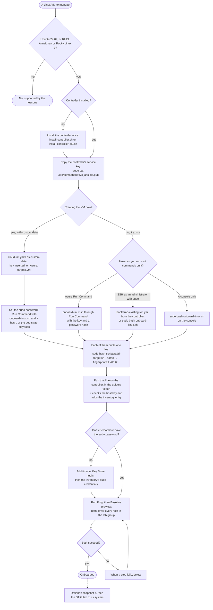

# From a VM to an onboarded target

[Back to the guide](../README.md)

This page shows every path from a Linux VM, new or already running, on any
hypervisor or cloud, to a target that the controller's Ansible and Semaphore
can manage, and which file does each step. The chapters it links to explain
the details; this page is the map.

A target is **onboarded** when all four hold:

1. `svc_ansible` exists on it, logs in with the controller's key only, and
   uses sudo with its own password.
2. The controller's inventory lists it, and its verified host key is trusted.
3. Semaphore has its sudo password.
4. **Ping** and **Baseline preview** succeed for it.

## The flow

## Step by step

| Step | Where | Do | Check |
| --- | --- | --- | --- |
| 1. Controller | The controller VM, as its administrator | Install once with [`install-controller.sh`](../scripts/install-controller.sh) on Ubuntu 24.04 ([chapter 3](03-controller.md)) or [`install-controller-el9.sh`](../scripts/install-controller-el9.sh) on RHEL, AlmaLinux or Rocky Linux 9 ([chapter 3b](03-controller-el9.md)). | The readiness report says `"passed": true`, and Semaphore lists 22 templates. |
| 2. Service key | The controller | `sudo cat /etc/semaphore/svc_ansible.pub` prints the key Semaphore logs in with. Insert it wherever the next step asks for the controller's key. | One line starting with `ssh-rsa`. |
| 3. Prepare `svc_ansible` | The VM, or the controller for the playbook | One of the four ways in [prepare the account](#prepare-the-account). | The run ends with `RESULT: OK`, `svc_ansible is ready`, or a play recap without failures, then the `add-target.sh` line. |
| 4. Sudo password | The VM, through the same channel | A SHA-512 hash from `openssl passwd -6` given to `onboard-linux.sh`, or the bootstrap playbook's prompt. cloud-init sets none. | The output says `password: set`. |
| 5. Add the target | The controller, in the guide's folder | Paste the printed `add-target.sh` line, after checking it is that one command. | `Added NAME ... and trusted its verified host key`, or `Already present` on a repeat. |
| 6. Semaphore's sudo password | Semaphore, once per password | [Give the templates the targets' sudo password](03-controller-el9.md#do-give-the-templates-the-targets-sudo-password): one shared password, or one per target with Vault. | The **Lab inventory file** shows the sudo credential. |
| 7. Verify | Semaphore | Run **Ping**, then **Baseline preview**. Both cover every host in the `lab` group, the new one included. | Both succeed for the new host; Ping names its distribution. |

### Prepare the account

| Your VM | Use | How |
| --- | --- | --- |
| You are creating it and can give it custom data | [`examples/onboard/cloud-init.yaml`](../examples/onboard/cloud-init.yaml) | Replace the quoted key placeholder with the service key and pass the file as custom data, or let [`examples/azure/targets.yml`](../examples/azure/targets.yml) do it. Set the password afterwards with one of the next two ways, then read the add-target line with [`inventory-info.sh`](../examples/onboard/inventory-info.sh) through Run Command or from the end of `/var/log/cloud-init-output.log`. |
| It exists, and Azure Run Command can reach it | [`examples/onboard/onboard-linux.sh`](../examples/onboard/onboard-linux.sh) | Paste the edited script into **Run command → RunShellScript**, or run it with `az vm run-command`, as [chapter 13](13-azure.md#do-onboard-an-existing-vm-with-run-command) shows. No SSH is needed. |
| It exists, and the controller can log in as its administrator | [`examples/bootstrap-existing-vm.yml`](../examples/bootstrap-existing-vm.yml) | Run it from the controller, one host at a time, as [chapter 13](13-azure.md#do-finish-access-with-one-playbook) shows; it asks for the sudo password. |
| It exists, and you have a console or SSH with sudo | `onboard-linux.sh` | Copy the edited script to the VM and run `sudo bash onboard-linux.sh`. |

Doing the same by hand is [chapter 4, steps 3 and 4](04-access.md).
Every way gives the same result and is safe to run again.

## On Azure, end to end

**Where: the machine with your Azure login, then the controller.** With a
controller from either installer and VMs created in the portal:

1. For each VM, open **Operations → Run command → RunShellScript**, paste
   [`onboard-linux.sh`](../examples/onboard/onboard-linux.sh) with the
   service key between the `END_OF_KEYS` lines and a hash from
   `openssl passwd -6` in `PASSWORD_HASH`, and run it. Set
   `CONTROLLER_ADDRESS` to the controller's private address, so the printed
   line carries the address the controller reaches.
2. On the controller, in the guide's folder, run the `add-target.sh` line
   that the output ends with.
3. In Semaphore, add the sudo password once, then run **Ping**, which covers
   every host in the `lab` group.

To create the VMs with Ansible as well, follow
[`examples/azure/`](../examples/azure/README.md): `network.yml`,
`controller.yml`, the installer, then `targets.yml`, whose cloud-init does
step 1 except the password. Rocky Linux needs its Marketplace terms accepted
once per subscription, and every VM needs a size your subscription has quota
for; [chapter 13](13-azure.md) has both.

## When a step fails

| Symptom | Likely cause | Next step |
| --- | --- | --- |
| `RESULT: FAILED: ...` from `onboard-linux.sh` | The message names it: a key the SSH policy refuses, a `NOPASSWD` rule, an SSH setting that overrides the account's | Fix what it names and run the script again; it changed nothing that would lock you out. |
| `add-target.sh` says `No scanned key matched` | The fingerprint is from another VM, or the VM was rebuilt | Read the fingerprint again through Run Command or the console; never take it from the scan. |
| `add-target.sh` says `Known-hosts already contains a different key` | The address belonged to an earlier VM | Verify why, then follow the commands it prints to remove the old key. |
| Ping fails with `Permission denied (publickey)` | `svc_ansible` lacks the service key, or an `AllowUsers`/`AllowGroups` rule leaves it out | Compare `sudo ssh-keygen -lf /home/svc_ansible/.ssh/authorized_keys` on the VM with the service key; run the onboarding again with the right key. |
| Ping fails with `Host key verification failed` | The VM's key changed after it was added | As for `add-target.sh` above. |
| Baseline preview says `Missing sudo password` | Semaphore has no sudo password for the inventory | Step 6. |
| `Incorrect sudo password`, or the account is locked after several | Semaphore's password differs from the VM's, and after a vendor STIG `faillock` locks after three failures | Fix the password in Semaphore; reset the lock with `faillock --user svc_ansible --reset` through Run Command. |

[Troubleshooting](11-troubleshooting.md) covers the rest, in the same order
as the layers: network, SSH, sudo, then Semaphore.

## The files

| File | Runs on | Step |
| --- | --- | --- |
| [`scripts/install-controller.sh`](../scripts/install-controller.sh), [`scripts/install-controller-el9.sh`](../scripts/install-controller-el9.sh) | The controller | 1 |
| [`examples/onboard/cloud-init.yaml`](../examples/onboard/cloud-init.yaml) | The VM, at first boot | 3 |
| [`examples/onboard/onboard-linux.sh`](../examples/onboard/onboard-linux.sh) | The VM, as root | 3, 4 |
| [`examples/bootstrap-existing-vm.yml`](../examples/bootstrap-existing-vm.yml) | The controller | 3, 4 |
| [`examples/onboard/inventory-info.sh`](../examples/onboard/inventory-info.sh) | The VM, read-only | 5 |
| [`scripts/add-target.sh`](../scripts/add-target.sh) | The controller | 5 |
| [`examples/azure/`](../examples/azure/README.md) | Your workstation | Azure VMs |

The [validation record](validation/2026-10-onboarding.md) lists what each
path did in a live run on Azure, with RHEL, AlmaLinux, Rocky Linux and Ubuntu
Pro targets.
